# Brazil 2026 General Elections — full analysis

A complete, reproducible reading of the October 2026 Brazilian general elections (first round
4 October, runoff 25 October), built from the official TSE open data and the IBGE 2022
territorial meshes: the presidential race in two rounds, 27 governorships, 54 of the 81 Senate
seats, 513 Chamber seats and 1,059 state/district seats, and the age, gender and schooling
profile of the 158.7 million voters behind them.

Every result in this report is regenerated from the Parquet caches, and every table has a
counterpart in the notebooks. The four notebooks are published as cross-linked HTML pages
(nav bar, table of contents, previous/next), so the analysis can be read without installing
anything.

| | Notebook | Read online | Source |
|---|---|---|---|
| 00 | Data, preprocessing and validation | [HTML](outputs/html_notebooks/00_data_preprocessing_validation.html) | [.ipynb](00_data_preprocessing_validation.ipynb) |
| 01 | National panorama | [HTML](outputs/html_notebooks/01_panorama_nacional.html) | [.ipynb](01_panorama_nacional.ipynb) |
| 02 | States, Congress and the Senate | [HTML](outputs/html_notebooks/02_estados_congresso_senado.html) | [.ipynb](02_estados_congresso_senado.ipynb) |
| 03 | Electorate, age and demography | [HTML](outputs/html_notebooks/03_eleitorado_idade_demografia.html) | [.ipynb](03_eleitorado_idade_demografia.ipynb) |

Landing page with the highlight numbers and the figure gallery:
[outputs/index.html](outputs/index.html).

## Data sources and official references

All data is public and comes from two publishers. The downloader in notebook 00 (Step 0)
fetches exactly these files; nothing is scraped, and no private source is used.

| Source | Publisher | Official location |
|---|---|---|
| Results by candidate, municipality and electoral zone, 27 state files | Tribunal Superior Eleitoral | [votacao_candidato_munzona_2026.zip](https://cdn.tse.jus.br/estatistica/sead/odsele/votacao_candidato_munzona/votacao_candidato_munzona_2026.zip) |
| Vote detail per municipality and zone: turnout, abstention, null and blank votes | TSE | [detalhe_votacao_munzona_2026.zip](https://cdn.tse.jus.br/estatistica/sead/odsele/detalhe_votacao_munzona/detalhe_votacao_munzona_2026.zip) |
| Votes by polling station, presidential race (5.7 million rows) | TSE | [votacao_secao_2026_BR.zip](https://cdn.tse.jus.br/estatistica/sead/odsele/votacao_secao/votacao_secao_2026_BR.zip) |
| Electorate by municipality, age, gender, schooling and marital status | TSE | [perfil_eleitorado_2026.zip](https://cdn.tse.jus.br/estatistica/sead/odsele/perfil_eleitorado/perfil_eleitorado_2026.zip) |
| Candidate registry: party, birth date, gender, race, schooling, occupation | TSE | [consulta_cand_2026.zip](https://cdn.tse.jus.br/estatistica/sead/odsele/consulta_cand/consulta_cand_2026.zip) |
| State and municipal territorial meshes, 2022 edition | IBGE | [Malhas territoriais](https://www.ibge.gov.br/geociencias/organizacao-do-territorio/malhas-territoriais.html) |
| Municipality list: IBGE codes, names and state | IBGE | [Localidades API](https://servicodados.ibge.gov.br/api/v1/localidades/municipios) |

Portals and documentation:

* TSE open data — [dadosabertos.tse.jus.br](https://dadosabertos.tse.jus.br/) — datasets, dictionaries and
  the file layout used here.
* TSE election results — [resultados.tse.jus.br](https://resultados.tse.jus.br/) — the official totals this
  project reconciles against.
* TSE — [tse.jus.br](https://www.tse.jus.br/) — resolutions, calendars and statistics.
* IBGE — [ibge.gov.br](https://www.ibge.gov.br/) — territorial division and population estimates.

Technical notes on the files: all CSVs are latin-1 encoded with a semicolon separator and a
header row; the 2026 archives sit in the same folder structure as previous years, so the
downloader is version-agnostic. Sizes in this report are the uncompressed CSVs: 7.5 GB of TSE
text becomes 335 MB of Parquet, which is what the notebooks read.

## Headline numbers

| Indicator | Result |
|---|---|
| Registered voters | 158,745,463 (157,826,587 in Brazil + 918,876 abroad) |
| Turnout, 1st round | **79.1%** — 124,768,485 of 157,646,356 |
| Abstention, 1st round | 20.9% — 32,877,871 voters |
| Runoff winner | **Lula (PT) 51.79%** — 64,256,232 votes |
| Runner-up | Flávio Bolsonaro (PL) 48.21% — 59,826,041 votes |
| Chamber of Deputies | 513 seats, 20 parties — **PL 121**, PT 70, UNIÃO 46 |
| Senate (2026 class) | 54 seats — **PL 19**, MDB 7, PT 6 |
| Governors | 27 — **PL 6**, PSD 5, PP 4, PT 4, Republicanos 4 |
| State/district assemblies | 1,059 seats — PL 212, PT 141, MDB 112 |
| Median age of voters | 43.3 years; 60+ is 23.7%, 16-24 is 12.1%; women 52.8% |

## Contents

0. [Data sources and official references](#data-sources-and-official-references)
1. [The electorate and turnout](#1-the-electorate-and-turnout)
2. [The presidential election](#2-the-presidential-election)
3. [Congress](#3-congress)
4. [State assemblies](#4-state-assemblies)
5. [The 27 states in one table](#5-the-27-states-in-one-table)
6. [Who votes: age, gender and schooling](#6-who-votes-age-gender-and-schooling)
7. [Validation of the data](#7-validation-of-the-data)
8. [What the numbers mean](#8-what-the-numbers-mean)
9. [How the analysis is built](#9-how-the-analysis-is-built)
10. [Reproducing](#10-reproducing)
11. [Method notes and limitations](#11-method-notes-and-limitations)
12. [Artifact index](#12-artifact-index)

---

## 1. The electorate and turnout

Brazil went to the polls with **158,745,463 registered voters**, 157,826,587 of them in the
country and 918,876 abroad. Turnout is compulsory but far from uniform: **84.5%** in
CE against **76.1%** in MS, a spread of 8.4 points.

[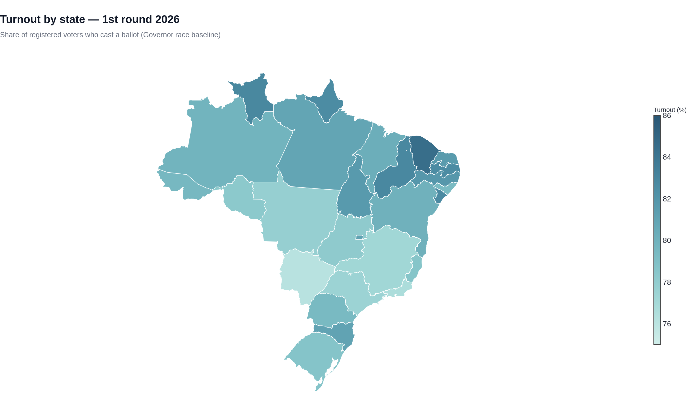](outputs/html/n1_turnout_uf.html)

| UF | State | Region | Electorate | Voted | Turnout % | Abstention % | Blank % | Null % |
|:---|:---|:---|---:|---:|---:|---:|---:|---:|
| CE | Ceará | Northeast | 6,991,044 | 5,905,522 | 84.5 | 15.5 | 2.9 | 5.6 |
| RR | Roraima | North | 400,603 | 331,959 | 82.9 | 17.1 | 1.1 | 2.7 |
| PI | Piauí | Northeast | 2,703,064 | 2,239,386 | 82.8 | 17.2 | 3.4 | 6.1 |
| SE | Sergipe | Northeast | 1,737,460 | 1,436,609 | 82.7 | 17.3 | 3.8 | 10.8 |
| PB | Paraíba | Northeast | 3,241,966 | 2,677,904 | 82.6 | 17.4 | 4.8 | 9.8 |
| AP | Amapá | North | 576,359 | 476,019 | 82.6 | 17.4 | 0.6 | 5.1 |
| PE | Pernambuco | Northeast | 7,216,989 | 5,905,236 | 81.8 | 18.2 | 2.6 | 8.2 |
| TO | Tocantins | North | 1,180,433 | 963,810 | 81.6 | 18.4 | 2.8 | 9.1 |
| RN | Rio Grande do Norte | Northeast | 2,656,207 | 2,167,714 | 81.6 | 18.4 | 3.5 | 4.8 |
| SC | Santa Catarina | South | 5,719,541 | 4,634,550 | 81.0 | 19.0 | 3.7 | 4.3 |
| DF | Distrito Federal | Centre-West | 2,243,988 | 1,817,921 | 81.0 | 19.0 | 4.1 | 4.9 |
| PA | Pará | North | 6,258,162 | 5,062,750 | 80.9 | 19.1 | 2.1 | 7.7 |
| MA | Maranhão | Northeast | 5,180,851 | 4,158,395 | 80.3 | 19.7 | 2.3 | 4.1 |
| BA | Bahia | Northeast | 11,304,314 | 9,046,179 | 80.0 | 20.0 | 2.6 | 5.8 |
| AM | Amazonas | North | 2,796,053 | 2,232,271 | 79.8 | 20.2 | 2.3 | 4.9 |
| AC | Acre | North | 613,316 | 487,971 | 79.6 | 20.4 | 1.8 | 8.1 |
| PR | Paraná | South | 8,600,624 | 6,829,615 | 79.4 | 20.6 | 4.1 | 4.5 |
| AL | Alagoas | Northeast | 2,439,190 | 1,935,820 | 79.4 | 20.6 | 2.9 | 8.8 |
| RS | Rio Grande do Sul | South | 8,516,465 | 6,697,424 | 78.6 | 21.4 | 4.8 | 4.7 |
| ES | Espírito Santo | Southeast | 2,987,584 | 2,348,612 | 78.6 | 21.4 | 4.7 | 5.4 |
| RO | Rondônia | North | 1,265,008 | 990,313 | 78.3 | 21.7 | 2.4 | 2.2 |
| GO | Goiás | Centre-West | 5,074,870 | 3,966,488 | 78.2 | 21.8 | 4.3 | 4.2 |
| MT | Mato Grosso | Centre-West | 2,634,992 | 2,049,718 | 77.8 | 22.2 | 4.0 | 5.4 |
| SP | São Paulo | Southeast | 34,081,699 | 26,394,256 | 77.4 | 22.6 | 5.1 | 7.3 |
| MG | Minas Gerais | Southeast | 16,361,188 | 12,627,167 | 77.2 | 22.8 | 5.2 | 4.4 |
| RJ | Rio de Janeiro | Southeast | 12,842,517 | 9,845,867 | 76.7 | 23.3 | 5.1 | 9.6 |
| MS | Mato Grosso do Sul | Centre-West | 2,021,869 | 1,539,009 | 76.1 | 23.9 | 5.2 | 6.2 |

Regional averages, and the same figures by region:

| Region | Electorate | Voted | Turnout % | Abstention % |
|:---|---:|---:|---:|---:|
| Northeast | 43,471,085 | 35,472,765 | 81.6 | 18.4 |
| North | 13,089,934 | 10,545,093 | 80.6 | 19.4 |
| South | 22,836,630 | 18,161,589 | 79.5 | 20.5 |
| Centre-West | 11,975,719 | 9,373,136 | 78.3 | 21.7 |
| Southeast | 66,272,988 | 51,215,902 | 77.3 | 22.7 |

Abstention weighs most where the electorate is largest: São Paulo (7.7 M absent voters), Minas
Gerais (3.7 M) and Rio de Janeiro (3.0 M). Invalid votes behave differently — nulls run from
2.2% in Rondônia to 10.8% in Sergipe, and blanks peak at 5.2% in Mato Grosso do Sul and Minas
Gerais. Null voting is a political signal, not an administrative accident.

The distribution of turnout across the 5,571 municipalities: median **79.4%**, 10th
percentile 74.3%, 90th percentile 84.3%. Notebook 01 also lists the ten highest and ten
lowest municipal turnouts with their electorates.

---

## 2. The presidential election

### First round — 4 October 2026

Thirteen candidates, but only two above 3%: Flávio Bolsonaro (PL) 47.03% and Lula (PT) 45.16%.
Valid votes: **119,306,034**; blank and null added 5,969,801 more ballots.

| Candidate | Party | Votes | % valid |
|:---|:---|---:|---:|
| Flávio Bolsonaro | PL | 56,104,503 | 47.03 |
| Lula | PT | 53,879,538 | 45.16 |
| Augusto Cury | AVANTE | 3,448,569 | 2.89 |
| Renan Santos | MISSÃO | 2,675,887 | 2.24 |
| Ronaldo Caiado | PSD | 2,605,148 | 2.18 |
| Romeu Zema | NOVO | 326,488 | 0.27 |
| Samara Martins | UP | 122,911 | 0.10 |
| Hertz Dias | PSTU | 43,103 | 0.04 |
| Clariana Barao | DC | 40,043 | 0.03 |
| Edmilson Costa | PCB | 22,693 | 0.02 |
| Wilson Grassi | DEMOCRATA | 16,881 | 0.01 |
| Rui Costa Pimenta | PCO | 15,024 | 0.01 |
| Leonardo Alves | PRTB | 5,246 | 0.00 |
| Null | — | 3,669,003 | — |
| Blank | — | 2,300,798 | — |

[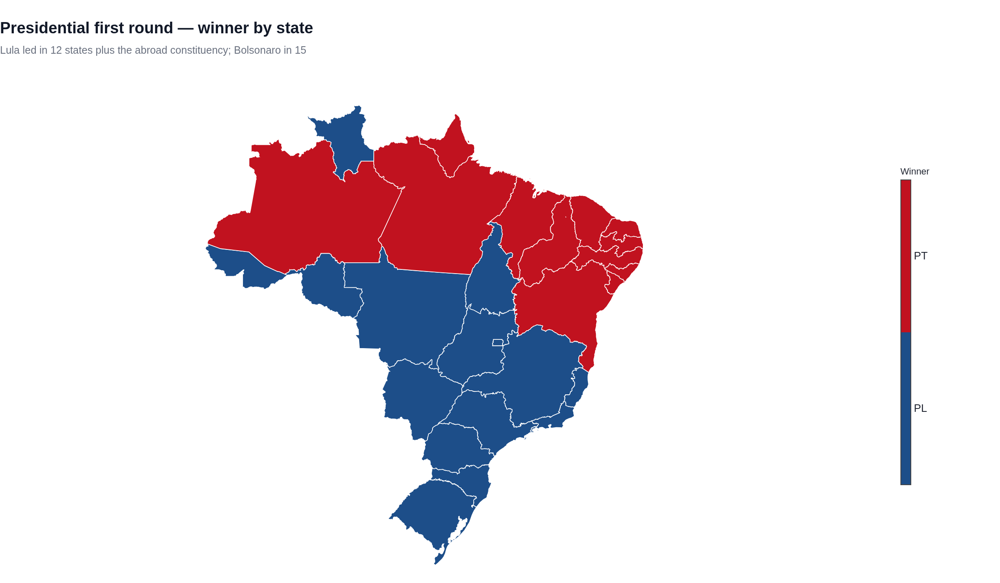](outputs/html/n1_pres1_winner.html)

Bolsonaro led in **15 states**, Lula in **12 plus the abroad constituency**:

| UF | State | Winner | % | Runner-up | % | Margin |
|:---|:---|:---|---:|:---|---:|---:|
| AC | Acre | Flávio Bolsonaro | 64.6 | Lula | 28.7 | 35.8 |
| AL | Alagoas | Lula | 54.7 | Flávio Bolsonaro | 40.4 | 14.3 |
| AM | Amazonas | Lula | 48.2 | Flávio Bolsonaro | 45.0 | 3.2 |
| AP | Amapá | Lula | 45.7 | Flávio Bolsonaro | 45.7 | 0.05 |
| BA | Bahia | Lula | 66.2 | Flávio Bolsonaro | 28.5 | 37.6 |
| CE | Ceará | Lula | 63.3 | Flávio Bolsonaro | 31.3 | 32.0 |
| DF | Distrito Federal | Flávio Bolsonaro | 51.3 | Lula | 38.1 | 13.2 |
| ES | Espírito Santo | Flávio Bolsonaro | 54.8 | Lula | 37.8 | 17.0 |
| GO | Goiás | Flávio Bolsonaro | 53.6 | Lula | 31.1 | 22.5 |
| MA | Maranhão | Lula | 64.0 | Flávio Bolsonaro | 30.9 | 33.1 |
| MG | Minas Gerais | Flávio Bolsonaro | 48.2 | Lula | 43.3 | 4.9 |
| MS | Mato Grosso do Sul | Flávio Bolsonaro | 58.6 | Lula | 34.7 | 23.9 |
| MT | Mato Grosso | Flávio Bolsonaro | 65.1 | Lula | 29.2 | 36.0 |
| PA | Pará | Lula | 49.9 | Flávio Bolsonaro | 44.5 | 5.4 |
| PB | Paraíba | Lula | 61.3 | Flávio Bolsonaro | 33.1 | 28.2 |
| PE | Pernambuco | Lula | 63.5 | Flávio Bolsonaro | 31.0 | 32.4 |
| PI | Piauí | Lula | 71.0 | Flávio Bolsonaro | 24.1 | 46.9 |
| PR | Paraná | Flávio Bolsonaro | 59.9 | Lula | 31.2 | 28.7 |
| RJ | Rio de Janeiro | Flávio Bolsonaro | 53.0 | Lula | 39.4 | 13.6 |
| RN | Rio Grande do Norte | Lula | 59.7 | Flávio Bolsonaro | 34.8 | 25.0 |
| RO | Rondônia | Flávio Bolsonaro | 67.4 | Lula | 25.9 | 41.6 |
| RR | Roraima | Flávio Bolsonaro | 71.1 | Lula | 22.9 | 48.2 |
| RS | Rio Grande do Sul | Flávio Bolsonaro | 55.6 | Lula | 35.7 | 19.9 |
| SC | Santa Catarina | Flávio Bolsonaro | 66.7 | Lula | 25.0 | 41.6 |
| SE | Sergipe | Lula | 62.7 | Flávio Bolsonaro | 30.6 | 32.1 |
| SP | São Paulo | Flávio Bolsonaro | 51.9 | Lula | 38.2 | 13.7 |
| TO | Tocantins | Flávio Bolsonaro | 50.4 | Lula | 43.4 | 7.0 |
| ZZ | Abroad | Lula | 47.5 | Flávio Bolsonaro | 43.5 | 4.1 |

The country split in three blocs: the **Northeast** (63.8% Lula) and, narrowly, the **North**
(49.1-44.6 for Bolsonaro); the **South** (60.1% Bolsonaro), **Centre-West** (56.5%) and
**Southeast** (51.4%). Lula's 33-point lead in the Northeast produced a surplus no southern
majority could offset.

### Runoff — 25 October 2026

| Candidate | Party | Votes | % valid |
|:---|:---|---:|---:|
| Lula | PT | 64,256,232 | 51.79 |
| Flávio Bolsonaro | PL | 59,826,041 | 48.21 |

Margin: **4,430,191 votes (3.57 points)**. Turnout rose to 81.3%
(128,236,074 ballots); blank and null fell from 5,969,801 to
4,153,801.

[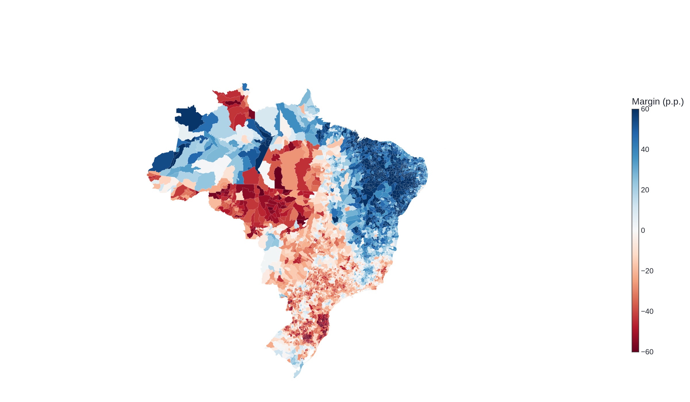](outputs/html/n1_runoff_margin_municipal.html)

Lula carried **2,875 of 5,571 municipalities**, Bolsonaro 2,695 (one tied) — the blue Northeast and the
Amazonian river municipalities against the red interior of the South, Centre-West and the
agro-industrial belt. The runoff **consolidated rather than re-aligned** the country: Lula
gained in 5,567 municipalities (median gain 5.13 points) and the extra turnout (+3.5 M
ballots) was larger in Bolsonaro's strongholds. The swing came from vote transfer, not from
mobilisation.

| UF | State | Region | Lula % | Bolsonaro % | Margin (p.p.) |
|:---|:---|:---|---:|---:|---:|
| AC | Acre | North | 33.4 | 66.6 | -33.1 |
| AL | Alagoas | Northeast | 60.8 | 39.2 | 21.5 |
| AM | Amazonas | North | 54.0 | 46.0 | 8.0 |
| AP | Amapá | North | 52.9 | 47.1 | 5.8 |
| BA | Bahia | Northeast | 71.3 | 28.7 | 42.6 |
| CE | Ceará | Northeast | 68.9 | 31.1 | 37.9 |
| DF | Distrito Federal | Centre-West | 45.7 | 54.3 | -8.6 |
| ES | Espírito Santo | Southeast | 43.6 | 56.4 | -12.7 |
| GO | Goiás | Centre-West | 40.3 | 59.7 | -19.3 |
| MA | Maranhão | Northeast | 69.5 | 30.5 | 39.1 |
| MG | Minas Gerais | Southeast | 50.4 | 49.6 | 0.9 |
| MS | Mato Grosso do Sul | Centre-West | 40.4 | 59.6 | -19.2 |
| MT | Mato Grosso | Centre-West | 33.9 | 66.1 | -32.1 |
| PA | Pará | North | 55.0 | 45.0 | 10.0 |
| PB | Paraíba | Northeast | 67.5 | 32.5 | 34.9 |
| PE | Pernambuco | Northeast | 69.2 | 30.8 | 38.4 |
| PI | Piauí | Northeast | 75.9 | 24.1 | 51.8 |
| PR | Paraná | South | 37.4 | 62.6 | -25.2 |
| RJ | Rio de Janeiro | Southeast | 46.9 | 53.1 | -6.2 |
| RN | Rio Grande do Norte | Northeast | 65.7 | 34.3 | 31.4 |
| RO | Rondônia | North | 30.4 | 69.6 | -39.2 |
| RR | Roraima | North | 27.5 | 72.5 | -44.9 |
| RS | Rio Grande do Sul | South | 42.2 | 57.8 | -15.7 |
| SC | Santa Catarina | South | 30.6 | 69.4 | -38.8 |
| SE | Sergipe | Northeast | 69.5 | 30.5 | 39.1 |
| SP | São Paulo | Southeast | 46.2 | 53.8 | -7.7 |
| TO | Tocantins | North | 48.6 | 51.4 | -2.7 |
| ZZ | Abroad | Abroad | 53.9 | 46.1 | 7.7 |

---

## 3. Congress

### Chamber of Deputies — 513 seats, 20 parties

| Party | Seats | Nominal votes | Vote % | Seat % | Seat/vote |
|:---|---:|---:|---:|---:|---:|
| PL | 121 | 25,206,796 | 22.79 | 23.59 | 1.04 |
| PT | 70 | 13,783,223 | 12.46 | 13.65 | 1.10 |
| UNIÃO | 46 | 7,750,929 | 7.01 | 8.97 | 1.28 |
| PSD | 43 | 9,229,863 | 8.34 | 8.38 | 1.00 |
| REPUBLICANOS | 41 | 7,852,325 | 7.10 | 7.99 | 1.13 |
| PP | 41 | 7,392,286 | 6.68 | 7.99 | 1.20 |
| MDB | 36 | 7,745,890 | 7.00 | 7.02 | 1.00 |
| PODE | 27 | 5,835,697 | 5.28 | 5.26 | 1.00 |
| PSB | 15 | 4,915,164 | 4.44 | 2.92 | 0.66 |
| PSOL | 14 | 5,212,639 | 4.71 | 2.73 | 0.58 |
| PSDB | 11 | 2,841,745 | 2.57 | 2.14 | 0.83 |
| PCDOB | 11 | 1,271,806 | 1.15 | 2.14 | 1.87 |
| NOVO | 10 | 2,855,354 | 2.58 | 1.95 | 0.76 |
| PV | 7 | 1,325,085 | 1.20 | 1.36 | 1.14 |
| PDT | 6 | 1,664,840 | 1.50 | 1.17 | 0.78 |
| AVANTE | 5 | 1,787,457 | 1.62 | 0.97 | 0.60 |
| PRD | 5 | 1,163,862 | 1.05 | 0.97 | 0.93 |
| SOLIDARIEDADE | 2 | 911,522 | 0.82 | 0.39 | 0.47 |
| MISSÃO | 1 | 1,151,754 | 1.04 | 0.19 | 0.19 |
| REDE | 1 | 213,953 | 0.19 | 0.19 | 1.01 |

[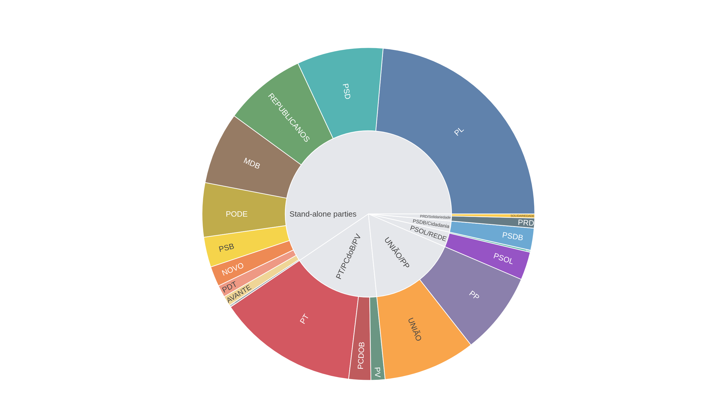](outputs/html/n1_chamber_sunburst.html)

Because the five **federations** compete as single organisations in proportional elections,
they are the real units of the chamber:

| Federation | Seats | Nominal votes | Seat % |
|:---|---:|---:|---:|
| PL | 121 | 25,206,796 | 23.6 |
| PT/PCdoB/PV | 88 | 16,380,114 | 17.2 |
| UNIÃO/PP | 87 | 15,143,215 | 17.0 |
| PSD | 43 | 9,229,863 | 8.4 |
| REPUBLICANOS | 41 | 7,852,325 | 8.0 |
| MDB | 36 | 7,745,890 | 7.0 |
| PODE | 27 | 5,835,697 | 5.3 |
| PSOL/REDE | 15 | 5,426,592 | 2.9 |
| PSB | 15 | 4,915,164 | 2.9 |
| PSDB/Cidadania | 11 | 3,098,006 | 2.1 |
| NOVO | 10 | 2,855,354 | 1.9 |
| PRD/Solidariedade | 7 | 2,075,384 | 1.4 |
| PDT | 6 | 1,664,840 | 1.2 |
| AVANTE | 5 | 1,787,457 | 1.0 |
| MISSÃO | 1 | 1,151,754 | 0.2 |

Parties that received votes but won no seat: CIDADANIA, DC, UP, MOBILIZA, DEMOCRATA, AGIR, PSTU, PCO.

Disproportionality: **Gallagher 3.0**, effective number of parties **9.7 by vote, 8.8 by seat**.
The PL converts 22.8% of the nominal vote into 23.6% of the seats; PSOL (4.7% to 2.7%) and
PSB (4.4% to 2.9%) are the most penalised large parties.

[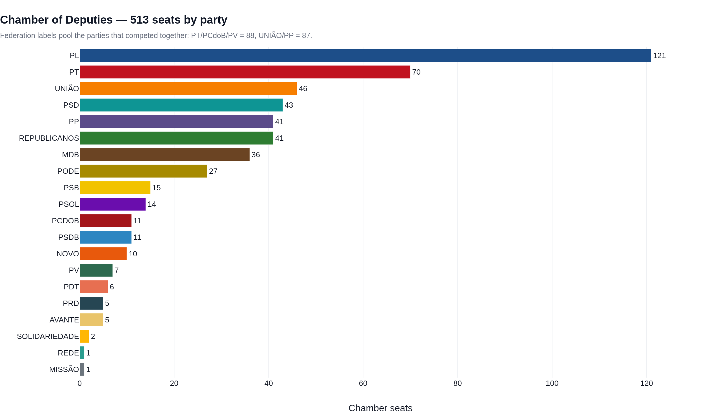](outputs/html/n2_chamber_party.html)

Delegations run from 8 deputies in the smallest states to 70 in São Paulo:

| UF | State | Deputies | Voters per deputy |
|:---|:---|---:|---:|
| SP | São Paulo | 70 | 486,881 |
| MG | Minas Gerais | 53 | 308,702 |
| RJ | Rio de Janeiro | 46 | 279,185 |
| BA | Bahia | 39 | 289,854 |
| RS | Rio Grande do Sul | 31 | 274,725 |
| PR | Paraná | 30 | 286,687 |
| PE | Pernambuco | 25 | 288,680 |
| CE | Ceará | 22 | 317,775 |
| MA | Maranhão | 18 | 287,825 |
| GO | Goiás | 17 | 298,522 |
| PA | Pará | 17 | 368,127 |
| SC | Santa Catarina | 16 | 357,471 |
| PB | Paraíba | 12 | 270,164 |
| ES | Espírito Santo | 10 | 298,758 |
| PI | Piauí | 10 | 270,306 |
| AL | Alagoas | 9 | 271,021 |
| AC | Acre | 8 | 76,664 |
| AP | Amapá | 8 | 72,045 |
| AM | Amazonas | 8 | 349,507 |
| DF | Distrito Federal | 8 | 280,498 |
| MT | Mato Grosso | 8 | 329,374 |
| MS | Mato Grosso do Sul | 8 | 252,734 |
| RN | Rio Grande do Norte | 8 | 332,026 |
| RO | Rondônia | 8 | 158,126 |
| RR | Roraima | 8 | 50,075 |
| SE | Sergipe | 8 | 217,182 |
| TO | Tocantins | 8 | 147,554 |

[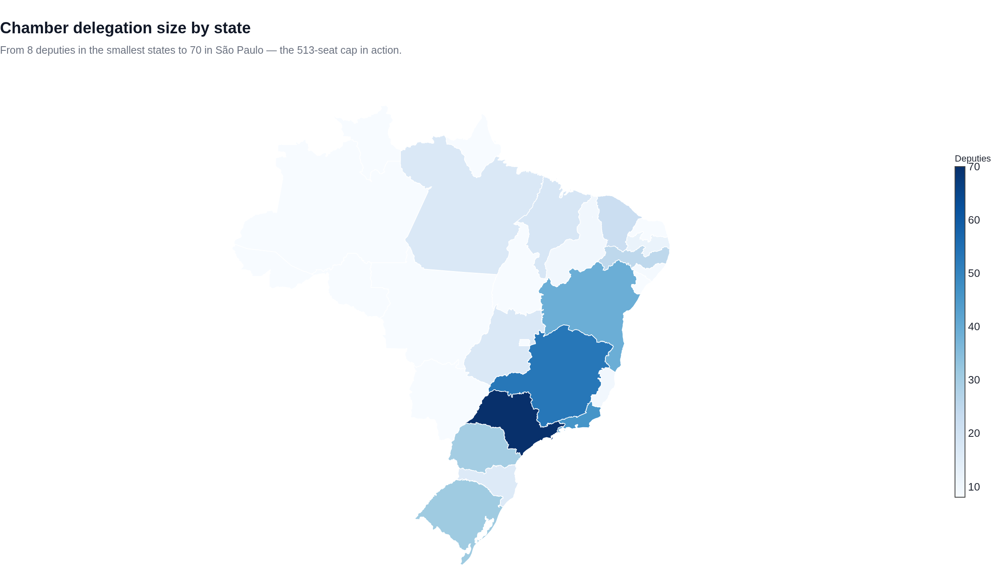](outputs/html/n2_chamber_seats_state.html)

### Senate — 54 seats renewed (two per state)

| Party | Seats |
|:---|---:|
| PL | 19 |
| MDB | 7 |
| PT | 6 |
| NOVO | 3 |
| PP | 3 |
| PSB | 3 |
| UNIÃO | 3 |
| PODE | 2 |
| PSD | 2 |
| PSDB | 2 |
| REPUBLICANOS | 2 |
| PDT | 1 |
| REDE | 1 |

[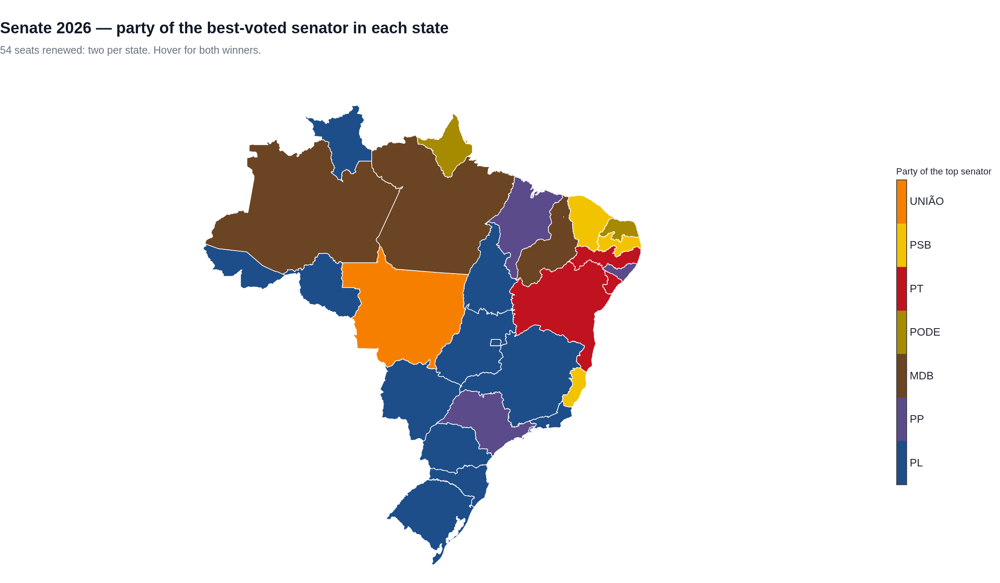](outputs/html/n2_senate_map.html)

The two-seat race fragments the vote: the median best-voted senator took 29.1% of the
state's valid Senate votes and no senator reached 36%. In **21 of 27 states** the two elected
senators came from different parties. All 54 winners:

| UF | Senator | Party | Votes | Share % |
|:---|:---|:---|---:|---:|
| AC | Marcio Bittar | PL | 223,972 | 25.6 |
| AC | Mara Rocha | REPUBLICANOS | 157,104 | 17.9 |
| AL | Arthur Lira | PP | 948,703 | 28.9 |
| AL | Marina JHC | PSDB | 926,860 | 28.2 |
| AM | Eduardo Braga | MDB | 1,240,471 | 32.3 |
| AM | Plinio Valério | PSDB | 948,793 | 24.7 |
| AP | Rayssa Furlan | PODE | 264,799 | 30.0 |
| AP | Lucas Barreto | PSD | 213,948 | 24.2 |
| BA | Rui Costa | PT | 4,335,196 | 30.1 |
| BA | Jaques Wagner | PT | 3,986,690 | 27.6 |
| CE | Cid Gomes | PSB | 3,033,562 | 31.2 |
| CE | Luizianne | REDE | 2,822,806 | 29.0 |
| DF | Michelle Bolsonaro | PL | 938,496 | 29.1 |
| DF | Bia Kicis | PL | 886,616 | 27.4 |
| ES | Renato Casagrande | PSB | 995,361 | 24.7 |
| ES | Evair de Melo | REPUBLICANOS | 982,978 | 24.4 |
| GO | Gustavo Gayer | PL | 1,639,247 | 24.5 |
| GO | Gracinha Caiado | UNIÃO | 1,458,522 | 21.8 |
| MA | Fufuca | PP | 1,530,187 | 21.4 |
| MA | Lahesio Bonfim | NOVO | 1,471,859 | 20.6 |
| MG | Domingos Sávio | PL | 4,968,829 | 24.2 |
| MG | Marília Campos | PT | 3,990,864 | 19.4 |
| MS | Reinaldo Azambuja | PL | 903,554 | 34.6 |
| MS | Capitão Contar | PL | 856,045 | 32.8 |
| MT | Mauro Mendes | UNIÃO | 1,187,352 | 33.2 |
| MT | Zé Medeiros | PL | 977,777 | 27.3 |
| PA | Helder | MDB | 2,342,070 | 26.1 |
| PA | Chicão | UNIÃO | 2,014,409 | 22.4 |
| PB | Joao Azevêdo | PSB | 1,391,994 | 32.5 |
| PB | Veneziano | MDB | 974,550 | 22.8 |
| PE | Humberto Costa | PT | 2,531,389 | 27.2 |
| PE | Marília Arraes | PDT | 2,325,127 | 25.0 |
| PI | Marcelo Castro | MDB | 1,307,833 | 35.7 |
| PI | Júlio César O Julim do Lula | PSD | 989,146 | 27.0 |
| PR | Filipe Barros | PL | 3,148,583 | 27.3 |
| PR | Deltan Dallagnol | NOVO | 2,904,594 | 25.1 |
| RJ | Carlos Portinho | PL | 4,264,932 | 26.8 |
| RJ | Carlos Jordy | PL | 3,912,405 | 24.6 |
| RN | Styvenson Valentim | PODE | 1,055,000 | 29.3 |
| RN | Samanda de Lula | PT | 635,924 | 17.6 |
| RO | Dr. Fernando Máximo | PL | 570,799 | 32.0 |
| RO | Bruno Scheid | PL | 474,226 | 26.6 |
| RR | Nicoletti | PL | 138,269 | 22.7 |
| RR | Teresa Surita | MDB | 117,270 | 19.2 |
| RS | Sanderson | PL | 3,453,316 | 30.1 |
| RS | Marcel Van Hattem | NOVO | 3,449,053 | 30.1 |
| SC | Carol de Toni | PL | 2,694,918 | 33.5 |
| SC | Carlos Bolsonaro | PL | 2,041,840 | 25.4 |
| SE | Rogerio Carvalho | PT | 511,142 | 21.9 |
| SE | Delegado Alessandro | MDB | 399,775 | 17.1 |
| SP | Guilherme Derrite | PP | 13,273,880 | 30.6 |
| SP | André do Prado | PL | 12,703,089 | 29.3 |
| TO | Eduardo Gomes | PL | 450,191 | 27.2 |
| TO | Alexandre Guimarães | MDB | 316,786 | 19.2 |

### Governors — 27 states, 8 parties

| UF | State | Governor | Party | Round | % | Runner-up | % |
|:---|:---|:---|:---|---:|---:|:---|---:|
| AC | Acre | Mailza Assis | PP | 2 | 66.2 | Alan Rick | 33.8 |
| AL | Alagoas | JHC | PSDB | 1 | 52.2 | Renan Filho | 47.4 |
| AM | Amazonas | Omar Aziz | PSD | 2 | 61.4 | Professora Maria do Carmo | 38.6 |
| AP | Amapá | Dr. Furlan | PSD | 1 | 62.8 | Clécio | 37.0 |
| BA | Bahia | Jerônimo Rodrigues | PT | 1 | 55.8 | Acm Neto | 43.7 |
| CE | Ceará | Elmano de Freitas | PT | 1 | 53.2 | Ciro Gomes | 46.2 |
| DF | Distrito Federal | Celina Leão | PP | 2 | 57.2 | Leandro Grass | 42.8 |
| ES | Espírito Santo | Lorenzo Pazolini | REPUBLICANOS | 2 | 52.2 | Ricardo Ferraço | 47.8 |
| GO | Goiás | Daniel Vilela | MDB | 1 | 59.2 | Wilder Morais | 22.0 |
| MA | Maranhão | Eduardo Braide | PSD | 1 | 54.0 | Orleans Brandão | 34.8 |
| MG | Minas Gerais | Cleitinho Azevedo | REPUBLICANOS | 1 | 55.4 | Patrus Ananias | 26.3 |
| MS | Mato Grosso do Sul | Eduardo Riedel | PP | 1 | 67.1 | Fábio Trad | 23.7 |
| MT | Mato Grosso | Otaviano Pivetta | REPUBLICANOS | 1 | 60.8 | Wellington Fagundes | 23.2 |
| PA | Pará | Dr. Daniel | PODE | 1 | 51.4 | Hana Ghassan | 46.5 |
| PB | Paraíba | Lucas Ribeiro | PP | 1 | 64.3 | Efraim Filho | 24.2 |
| PE | Pernambuco | Raquel Lyra | PSD | 1 | 53.3 | João Campos | 44.8 |
| PI | Piauí | Rafael Fonteles | PT | 1 | 70.9 | Joel Rodrigues | 27.5 |
| PR | Paraná | Sergio Moro | PL | 1 | 50.1 | Sandro Alex | 25.4 |
| RJ | Rio de Janeiro | Douglas Ruas | PL | 1 | 50.9 | Eduardo Paes | 44.2 |
| RN | Rio Grande do Norte | Cadu de Lula | PT | 2 | 50.8 | Allyson | 49.2 |
| RO | Rondônia | Marcos Rogério | PL | 1 | 56.9 | Adailton Furia | 20.1 |
| RR | Roraima | Arthur Henrique | PL | 1 | 69.1 | Soldado Sampaio | 29.3 |
| RS | Rio Grande do Sul | Zucco | PL | 1 | 58.0 | Juliana Brizola | 31.7 |
| SC | Santa Catarina | Jorginho Mello | PL | 1 | 69.0 | Gelson Merísio | 15.7 |
| SE | Sergipe | Fábio | PSD | 1 | 59.3 | Valmir de Francisquinho | 37.5 |
| SP | São Paulo | Tarcísio | REPUBLICANOS | 1 | 62.7 | Fernando Haddad | 36.4 |
| TO | Tocantins | Vicentinho Júnior | PSDB | 2 | 64.5 | Professora Dorinha | 35.5 |

[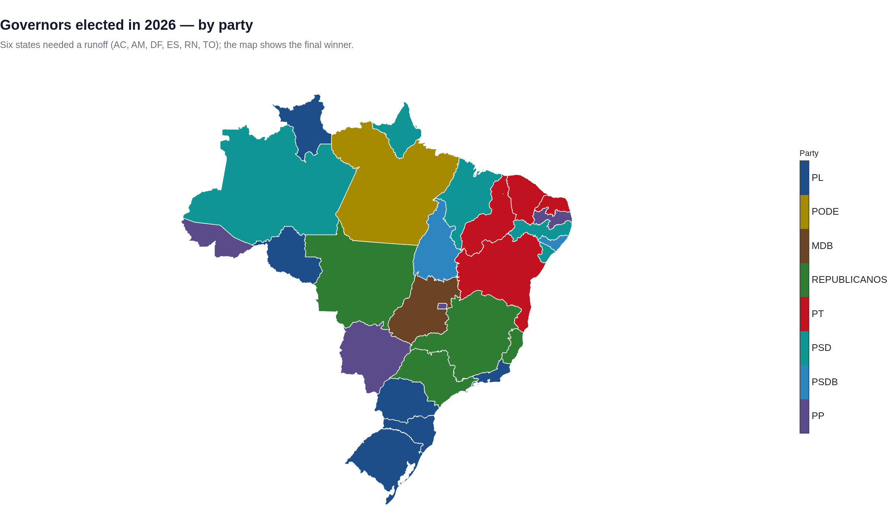](outputs/html/n2_governors_map.html)

Six states needed a runoff (AC, AM, DF, ES, RN, TO); in RN and TO the first-round leader lost.
Only **10 of 27** governors belong to the party that also won the presidential race in
their state: gubernatorial coalitions are built locally.

---

## 4. State assemblies

1,059 seats in 26 assemblies plus the Federal District:

| Party | Seats | Party | Seats |
|:---|---:|:---|---:|
| PL | 212 | AVANTE | 17 |
| PT | 141 | NOVO | 15 |
| MDB | 112 | PRD | 13 |
| PSD | 103 | PCDOB | 9 |
| PP | 81 | AGIR | 7 |
| REPUBLICANOS | 78 | SOLIDARIEDADE | 4 |
| UNIÃO | 73 | MOBILIZA | 3 |
| PODE | 47 | REDE | 3 |
| PSB | 42 | CIDADANIA | 1 |
| PSOL | 26 | DEMOCRATA | 1 |
| PSDB | 26 | MISSÃO | 1 |
| PDT | 24 | DC | 1 |
| PV | 19 |  |  |

The PL also leads the state legislatures, and the PT is relatively stronger there than in the
Chamber. Full per-state composition is in notebook 02 (section 3).

---

## 5. The 27 states in one table

Governor, both senators, delegation sizes and turnout, state by state:

| UF | State | Governor | Senators | Chamber | Assembly | Turnout % | Pres. winner |
|:---|:---|:---|:---|---:|---:|---:|:---|
| AC | Acre | Mailza Assis (PP) | Marcio Bittar (PL); Mara Rocha (REPUBLICANOS) | 8 | 24 | 79.6 | PL |
| AL | Alagoas | JHC (PSDB) | Arthur Lira (PP); Marina JHC (PSDB) | 9 | 27 | 79.4 | PT |
| AP | Amapá | Dr. Furlan (PSD) | Rayssa Furlan (PODE); Lucas Barreto (PSD) | 8 | 24 | 82.6 | PT |
| AM | Amazonas | Omar Aziz (PSD) | Eduardo Braga (MDB); Plinio Valério (PSDB) | 8 | 24 | 79.8 | PT |
| BA | Bahia | Jerônimo Rodrigues (PT) | Rui Costa (PT); Jaques Wagner (PT) | 39 | 63 | 80.0 | PT |
| CE | Ceará | Elmano de Freitas (PT) | Cid Gomes (PSB); Luizianne (REDE) | 22 | 46 | 84.5 | PT |
| DF | Distrito Federal | Celina Leão (PP) | Michelle Bolsonaro (PL); Bia Kicis (PL) | 8 | 24 | 81.0 | PL |
| ES | Espírito Santo | Lorenzo Pazolini (REPUBLICANOS) | Renato Casagrande (PSB); Evair de Melo (REPUBLICANOS) | 10 | 30 | 78.6 | PL |
| GO | Goiás | Daniel Vilela (MDB) | Gustavo Gayer (PL); Gracinha Caiado (UNIÃO) | 17 | 41 | 78.2 | PL |
| MA | Maranhão | Eduardo Braide (PSD) | Fufuca (PP); Lahesio Bonfim (NOVO) | 18 | 42 | 80.3 | PT |
| MT | Mato Grosso | Otaviano Pivetta (REPUBLICANOS) | Mauro Mendes (UNIÃO); Zé Medeiros (PL) | 8 | 24 | 77.8 | PL |
| MS | Mato Grosso do Sul | Eduardo Riedel (PP) | Reinaldo Azambuja (PL); Capitão Contar (PL) | 8 | 24 | 76.1 | PL |
| MG | Minas Gerais | Cleitinho Azevedo (REPUBLICANOS) | Domingos Sávio (PL); Marília Campos (PT) | 53 | 77 | 77.2 | PL |
| PA | Pará | Dr. Daniel (PODE) | Helder (MDB); Chicão (UNIÃO) | 17 | 41 | 80.9 | PT |
| PB | Paraíba | Lucas Ribeiro (PP) | Joao Azevêdo (PSB); Veneziano (MDB) | 12 | 36 | 82.6 | PT |
| PR | Paraná | Sergio Moro (PL) | Filipe Barros (PL); Deltan Dallagnol (NOVO) | 30 | 54 | 79.4 | PL |
| PE | Pernambuco | Raquel Lyra (PSD) | Humberto Costa (PT); Marília Arraes (PDT) | 25 | 49 | 81.8 | PT |
| PI | Piauí | Rafael Fonteles (PT) | Marcelo Castro (MDB); Júlio César O Julim do Lula (PSD) | 10 | 30 | 82.8 | PT |
| RJ | Rio de Janeiro | Douglas Ruas (PL) | Carlos Portinho (PL); Carlos Jordy (PL) | 46 | 70 | 76.7 | PL |
| RN | Rio Grande do Norte | Cadu de Lula (PT) | Styvenson Valentim (PODE); Samanda de Lula (PT) | 8 | 24 | 81.6 | PT |
| RS | Rio Grande do Sul | Zucco (PL) | Sanderson (PL); Marcel Van Hattem (NOVO) | 31 | 55 | 78.6 | PL |
| RO | Rondônia | Marcos Rogério (PL) | Dr. Fernando Máximo (PL); Bruno Scheid (PL) | 8 | 24 | 78.3 | PL |
| RR | Roraima | Arthur Henrique (PL) | Nicoletti (PL); Teresa Surita (MDB) | 8 | 24 | 82.9 | PL |
| SC | Santa Catarina | Jorginho Mello (PL) | Carol de Toni (PL); Carlos Bolsonaro (PL) | 16 | 40 | 81.0 | PL |
| SP | São Paulo | Tarcísio (REPUBLICANOS) | Guilherme Derrite (PP); André do Prado (PL) | 70 | 94 | 77.4 | PL |
| SE | Sergipe | Fábio (PSD) | Rogerio Carvalho (PT); Delegado Alessandro (MDB) | 8 | 24 | 82.7 | PT |
| TO | Tocantins | Vicentinho Júnior (PSDB) | Eduardo Gomes (PL); Alexandre Guimarães (MDB) | 8 | 24 | 81.6 | PL |

---

## 6. Who votes: age, gender and schooling

The 2026 register records every voter by municipality, age bracket, gender, schooling and
marital status. The median voter is **43.3 years old**; **52.8%** are women; **12.1%**
are 16-24 and **23.7%** are 60 or older.

[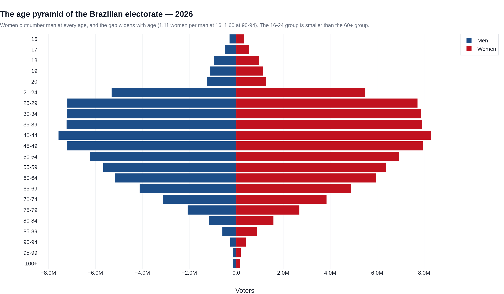](outputs/html/n3_age_pyramid.html)

| Age bracket | Voters | % |
|:---|---:|---:|
| 16 | 605,818 | 0.38 |
| 17 | 1,025,995 | 0.65 |
| 18 | 1,930,070 | 1.22 |
| 19 | 2,244,600 | 1.42 |
| 20 | 2,512,502 | 1.59 |
| 21-24 | 10,803,943 | 6.85 |
| 25-29 | 14,911,491 | 9.45 |
| 30-34 | 15,080,238 | 9.56 |
| 35-39 | 15,147,771 | 9.60 |
| 40-44 | 15,869,609 | 10.06 |
| 45-49 | 15,155,487 | 9.60 |
| 50-54 | 13,164,966 | 8.34 |
| 55-59 | 12,043,929 | 7.63 |
| 60-64 | 11,109,370 | 7.04 |
| 65-69 | 9,005,885 | 5.71 |
| 70-74 | 6,948,245 | 4.40 |
| 75-79 | 4,757,020 | 3.01 |
| 80-84 | 2,744,129 | 1.74 |
| 85-89 | 1,464,715 | 0.93 |
| 90-94 | 664,482 | 0.42 |
| 95-99 | 337,136 | 0.21 |
| 100+ | 297,977 | 0.19 |

### Electorate by state

| UF | State | Voters | Median age | 16-24 % | 60+ % | Aging ratio |
|:---|:---|---:|---:|---:|---:|---:|
| PA | Pará | 6,265,312 | 36.2 | 16.4 | 17.5 | 1.07 |
| MA | Maranhão | 5,186,532 | 36.9 | 17.1 | 18.9 | 1.11 |
| AP | Amapá | 577,533 | 37.3 | 18.0 | 14.7 | 0.82 |
| RR | Roraima | 401,490 | 37.6 | 18.5 | 15.6 | 0.84 |
| AM | Amazonas | 2,801,176 | 37.8 | 17.9 | 15.1 | 0.85 |
| AC | Acre | 614,367 | 38.0 | 18.3 | 15.9 | 0.87 |
| TO | Tocantins | 1,182,296 | 38.6 | 15.7 | 19.3 | 1.23 |
| AL | Alagoas | 2,441,728 | 39.1 | 14.8 | 19.7 | 1.33 |
| RO | Rondônia | 1,267,072 | 39.9 | 14.1 | 19.6 | 1.39 |
| CE | Ceará | 6,998,416 | 40.0 | 13.6 | 21.1 | 1.56 |
| SE | Sergipe | 1,740,116 | 40.1 | 13.7 | 20.1 | 1.47 |
| MT | Mato Grosso | 2,638,215 | 40.2 | 13.6 | 19.6 | 1.45 |
| PI | Piauí | 2,708,109 | 40.7 | 14.5 | 22.0 | 1.52 |
| ES | Espírito Santo | 2,990,457 | 40.9 | 10.8 | 24.8 | 2.30 |
| PR | Paraná | 8,608,993 | 41.1 | 11.2 | 24.9 | 2.23 |
| SP | São Paulo | 34,104,079 | 41.5 | 10.7 | 25.0 | 2.34 |
| PB | Paraíba | 3,247,342 | 41.6 | 13.7 | 22.3 | 1.63 |
| PE | Pernambuco | 7,225,615 | 41.7 | 13.1 | 21.9 | 1.66 |
| RN | Rio Grande do Norte | 2,660,514 | 41.8 | 12.9 | 22.5 | 1.74 |
| MG | Minas Gerais | 16,377,527 | 42.1 | 10.8 | 26.5 | 2.46 |
| BA | Bahia | 11,320,915 | 42.1 | 12.9 | 21.6 | 1.68 |
| GO | Goiás | 5,080,726 | 42.3 | 12.5 | 21.7 | 1.74 |
| DF | Distrito Federal | 2,253,125 | 42.4 | 11.7 | 20.4 | 1.75 |
| MS | Mato Grosso do Sul | 2,024,846 | 42.6 | 12.4 | 22.7 | 1.83 |
| RJ | Rio de Janeiro | 12,856,915 | 43.7 | 10.2 | 28.4 | 2.79 |
| SC | Santa Catarina | 5,725,731 | 43.8 | 10.7 | 24.0 | 2.23 |
| RS | Rio Grande do Sul | 8,526,231 | 44.8 | 9.5 | 29.8 | 3.15 |

[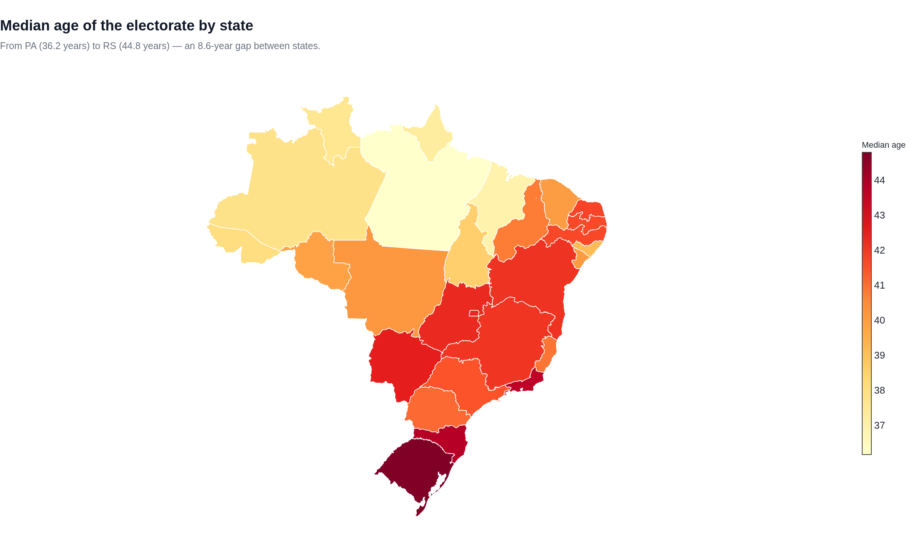](outputs/html/n3_median_age_state.html)

### Age structure by region

| Region | 16-24 | 25-44 | 45-59 | 60+ |
|:---|---:|---:|---:|---:|
| North | 16.6 | 42.6 | 23.7 | 17.1 |
| Northeast | 13.8 | 39.9 | 25.0 | 21.2 |
| Centre-West | 12.6 | 39.9 | 26.4 | 21.2 |
| Southeast | 10.6 | 37.2 | 26.1 | 26.0 |
| South | 10.4 | 37.4 | 25.6 | 26.5 |

### Demography predicts the vote, not the turnout

[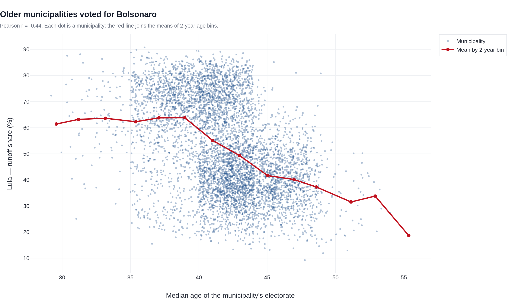](outputs/html/n3_lula_vs_age.html)

Correlations across the 5,571 municipalities:

|  | Median age | Youth | Turnout | Lula | Graduates | Illiteracy |
|:---|---:|---:|---:|---:|---:|---:|
| Median age | 1.00 | -0.85 | -0.03 | -0.44 | 0.38 | -0.41 |
| Youth | -0.85 | 1.00 | 0.02 | 0.56 | -0.48 | 0.55 |
| Turnout | -0.03 | 0.02 | 1.00 | 0.01 | 0.02 | -0.17 |
| Lula | -0.44 | 0.56 | 0.01 | 1.00 | -0.58 | 0.64 |
| Graduates | 0.38 | -0.48 | 0.02 | -0.58 | 1.00 | -0.57 |
| Illiteracy | -0.41 | 0.55 | -0.17 | 0.64 | -0.57 | 1.00 |

Ordinary least squares on municipal Lula vote (voters above 5,000, region dummies, HC1 errors):

| Variable | Model 1 (age only) | Model 2 (+ youth) |
|:---|---:|---:|
| Median age (years) | -0.39*** | +0.75*** |
| Youth 16-24 (%) | — | +1.93*** |
| Turnout (%) | -0.74*** | -0.57*** |
| log10 voters | -4.10*** | -2.78*** |
| Region: Northeast | +23.15*** | +25.39*** |
| Region: South | -12.19*** | -6.18*** |
| R² | 0.702 | 0.720 |
| N | 4,136 | 4,136 |

The two age measures are collinear (r = -0.85), so adding youth flips the sign of the
median-age coefficient. Read the models one at a time: in Model 1 a one-year older median is
associated with 0.39 points less Lula vote; in Model 2, controlling for age,
each extra point of 16-24 share is worth
1.93 points. Region dominates: the Northeast dummy is +23.2 points. **Turnout has no
demographic gradient at all** (r = -0.03 with median age), and conditional on region a
one-point higher turnout is associated with 0.74 points less Lula vote.

[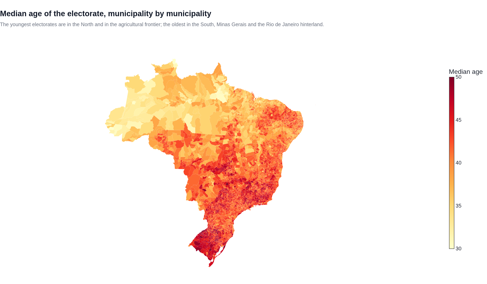](outputs/html/n3_median_age_municipal.html)

---

## 7. Validation of the data

Notebook 00 checks the caches before any analysis. The strongest check is the **exact
reconciliation** with the TSE's own totals: filtered to rows flagged *Válido*, the candidate
table reproduces the nominal valid votes of every office to the unit.

| Office | Candidate table | TSE nominal valid | Difference |
|:---|---:|---:|---:|
| Deputado Distrital | 1,626,978 | 1,626,978 | 0 |
| Deputado Estadual | 103,824,586 | 103,824,586 | 0 |
| Deputado Federal | 110,246,229 | 110,246,229 | 0 |
| Governador | 121,159,541 | 121,159,541 | 0 |
| Senador | 207,038,240 | 207,038,240 | 0 |

Annulled rows are kept in the cache but never enter an analysis:

| Destination | Votes | % of table |
|:---|---:|---:|
| Válido | 543,895,574 | 99.73 |
| Anulado sub judice | 1,386,317 | 0.25 |
| Anulado | 68,822 | 0.01 |
| Válido (legenda) | 16,884 | 0.00 |

Invariants checked in notebook 00:

| Check | Value | Expected |
|:---|---:|---:|
| Seats — federal deputies | 513 | 513 |
| Seats — senators | 54 | 54 |
| Seats — governors | 27 | 27 |
| Seats — state/district deputies | 1059 | 1059 |
| Crosswalk rows | 5571 | 5571 |
| Crosswalk without IBGE code | 0 | 0 |
| Crosswalk duplicate IBGE codes | 0 | 0 |
| State polygons | 27 | 27 |
| Municipal polygons | 5571 | 5571 |
| Registered voters (register vs aptos) | 157,825,378 | 157,646,356 |

---

## 8. What the numbers mean

1. **A legitimate but narrow runoff.** 3.57 points separate the two coalitions;
   Bolsonaro won 15 states and 2,695 municipalities (one tied), Lula 12 states plus the abroad constituency
   and 2,875 municipalities.
2. **The Northeast decided the election.** 33.7 million valid votes and a 63.8-30.9 split in the
   first round produced a surplus no southern majority could offset.
3. **The Congress is not the president's.** The PL (121), UNIÃO/PP (87), PSD (43), Republicanos (41),
   MDB (36) and PODE (27) hold 355 Chamber seats — 69% of the house — and the 2026 Senate class
   gives the PL 19 of 54 seats against 6 for the PT.
4. **Turnout is the silent variable.** The runoff added 3.5 million ballots, but they
   came disproportionately from Bolsonaro municipalities; Lula still won. Conversion, not
   mobilisation, decided 2026.
5. **The federation experiment worked.** Five federations elected 208 Chamber seats
   and 396 assembly seats; PT/PCdoB/PV is the second largest bloc in the Chamber.

---

## 9. How the analysis is built

| Source | Content | Size |
|---|---|---|
| votacao_candidato_munzona_2026 | nominal votes per candidate x municipality x zone, with party, federation and final situation | 6.0 GB, 27 files |
| detalhe_votacao_munzona_2026 | turnout, abstention, blank and null votes per municipality x office | 21 MB |
| votacao_secao_2026_BR | presidential votes by polling station (5.7 million rows) | 1.5 GB |
| perfil_eleitorado_2026 | electorate by municipality x age x gender x schooling | 2.1 GB |
| consulta_cand_2026 | candidate registry (party, birth date, gender, schooling) | 3.2 MB |
| IBGE 2022 meshes | state and municipal geometry, 5,571 municipalities | 17 MB |

Everything is read from **data/** inside the project (ELECTIONS_DATA can point elsewhere):

~~~
data/
├── raw/       TSE source CSVs          7.5 GB   (not committed)
├── source/    TSE archives             2.5 GB   (not committed)
├── geo/       IBGE meshes               27 MB   (committed)
└── cache/     Parquet tables           335 MB   (not committed)
~~~

| Notebook | Figures | Figures and tables |
|---|---|---|
| 00 | 2 | 12 validation tables: inventory, schema, reconciliation, invariants, geometry |
| 01 | 16 | 8 tables: turnout, candidates, state winners, runoff, seat/vote, federation, municipalities |
| 02 | 38 | 34 tables: the 27 state dossiers, Senate, Chamber, assemblies, proportionality |
| 03 | 10 | 4 tables: electorate, age structure, correlations, regression |

---

## 10. Reproducing

~~~bash
python3 -m pip install -r requirements.txt
jupyter lab            # or open the folder in VS Code with the same interpreter
~~~

Open 00 and run all cells: Step 0 downloads the sources (~11 GB), the next cell runs the
preprocessing pipeline (skipping what is already built), the rest validates it. Notebooks
01-03 read only the cache and execute in seconds.

~~~bash
python3 scripts/00_download.py          # optional: download only
python3 scripts/01_build_cache.py
python3 scripts/02_fetch_geo.py
python3 scripts/03_build_eleitorado.py
python3 scripts/04_crosswalk_geo.py
python3 scripts/05_crosswalk_fix.py
python3 scripts/06_enrich.py
python3 scripts/08_fix_winding.py
python3 scripts/07_merge_geo.py
~~~

The notebooks are committed already executed, and outputs/ holds the HTML pages built from
them, so reading the analysis needs nothing beyond a browser. scripts/ contains only the
setup pipeline: the downloader and the eight preprocessing steps that notebook 00 invokes.

Requirements: Python 3.9+ (developed on 3.13). On macOS the system Python often cannot build
shapely or duckdb wheels — a 3.11+ virtualenv is the safer route:

~~~bash
python3 -m venv .venv && source .venv/bin/activate
pip install -r requirements.txt ipykernel
python3 -m ipykernel install --user --name 2026-elections
~~~

---

## 11. Method notes and limitations

1. **Nominal votes only** for proportional offices. Party-list votes (3.43 M for the Chamber,
   7.22 M for the assemblies) are reported only as an aggregate and cannot be attributed to a
   party with these files, so party vote shares are slightly conservative.
2. **Senate** elects two senators per state; each voter casts two votes, so shares use valid
   Senate votes (~207 M) as denominator, exactly as the TSE does.
3. **Federations** are the real unit of competition in proportional elections; seat totals are
   shown by party and by federation.
4. **Territorial join**: the 5,571 TSE municipality codes were matched one-to-one to IBGE codes
   (13 cases resolved manually, e.g. Boa Saúde/RN, which the IBGE calls Januário Cicco).
   Voters abroad (UF ZZ) appear in national totals, not in municipal maps.
5. **Ecological inference**: all demographic-vote relationships are municipal aggregates, not
   individual behaviour. The TSE publishes no votes by age, gender or schooling.
6. Candidate situation fields are blank in the 2026 files; winners come from the final-round
   situation (DS_SIT_TOT_TURNO), which is complete.
7. Annulled votes (1.46 M rows, 0.27% of the candidate table) are kept in the cache but
   excluded from every analysis.

---

## 12. Artifact index

Every figure is also available as a standalone interactive page (Plotly, hoverable).

| Figure | Notebook | Static | Interactive |
|---|---|---|---|
| Turnout by state | 01 | [png](outputs/png/n1_turnout_uf.png) | [html](outputs/html/n1_turnout_uf.html) |
| Presidential 1st round, winner by state | 01 | [png](outputs/png/n1_pres1_winner.png) | [html](outputs/html/n1_pres1_winner.html) |
| Runoff margin by municipality | 01 | [png](outputs/png/n1_runoff_margin_municipal.png) | [html](outputs/html/n1_runoff_margin_municipal.html) |
| Chamber by federation (sunburst) | 01 | [png](outputs/png/n1_chamber_sunburst.png) | [html](outputs/html/n1_chamber_sunburst.html) |
| Chamber seats by party | 02 | [png](outputs/png/n2_chamber_party.png) | [html](outputs/html/n2_chamber_party.html) |
| Chamber delegation size by state | 02 | [png](outputs/png/n2_chamber_seats_state.png) | [html](outputs/html/n2_chamber_seats_state.html) |
| Senate by state | 02 | [png](outputs/png/n2_senate_map.png) | [html](outputs/html/n2_senate_map.html) |
| Governors by party | 02 | [png](outputs/png/n2_governors_map.png) | [html](outputs/html/n2_governors_map.html) |
| Age pyramid | 03 | [png](outputs/png/n3_age_pyramid.png) | [html](outputs/html/n3_age_pyramid.html) |
| Median age by state | 03 | [png](outputs/png/n3_median_age_state.png) | [html](outputs/html/n3_median_age_state.html) |
| Median age by municipality | 03 | [png](outputs/png/n3_median_age_municipal.png) | [html](outputs/html/n3_median_age_municipal.html) |
| Lula's share vs median age | 03 | [png](outputs/png/n3_lula_vs_age.png) | [html](outputs/html/n3_lula_vs_age.html) |

* [Landing page](outputs/index.html) — headline numbers and the figure gallery
* [Notebook 00](outputs/html_notebooks/00_data_preprocessing_validation.html) · [01](outputs/html_notebooks/01_panorama_nacional.html) · [02](outputs/html_notebooks/02_estados_congresso_senado.html) · [03](outputs/html_notebooks/03_eleitorado_idade_demografia.html)

**Data:** Tribunal Superior Eleitoral, open data 2026 · IBGE, malhas territoriais 2022.
**Code:** MIT. **Figures:** Plotly; notebooks executed with nbclient.
